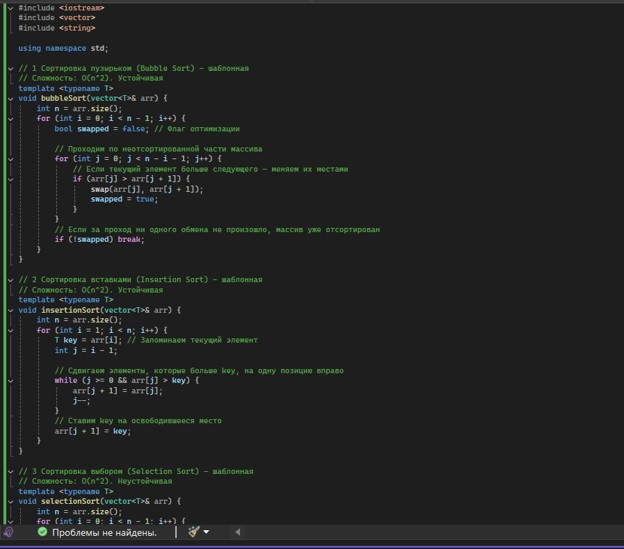
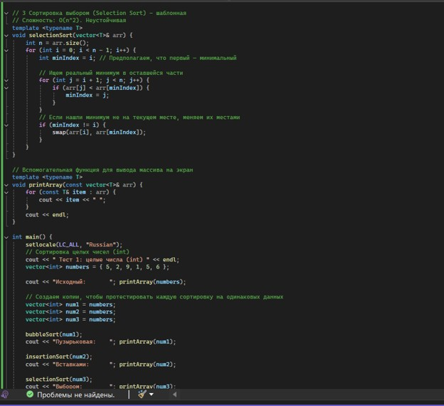
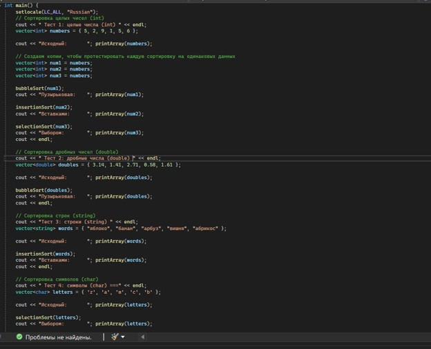
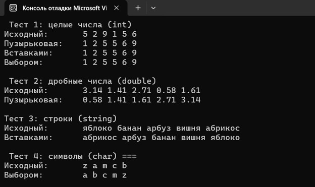

# Лабораторная работа №7
## Быстрая сортировка, сортировка слиянием, пирамидальная сортировка

**Выполнила:** *Агафонова Софья Сергеевна*  
**Группа:** *ПИЖ-б-о-25-1*  
**Вариант:** 1 (продвинутый уровень)
---

## Цель работы

1. Реализовать три эффективных алгоритма сортировки: быструю 
сортировку (Quick Sort), сортировку слиянием (Merge Sort) и 
пирамидальную сортировку (Heap Sort) 
2. Освоить принципы «разделяй и властвуй» на примере быстрой 
сортировки и сортировки слиянием 
3. Изучить структуру данных «куча» (heap) для реализации 
пирамидальной сортировки 
4. Проанализировать и сравнить производительность различных 
алгоритмов сортировки 
5. Понять преимущества и недостатки каждого алгоритма в 
различных сценариях использования
---
# Теоретическая часть

## 1. Понятие сортировки и её роль

**Сортировка** — это процесс упорядочивания элементов массива (или другой структуры данных) в определённом порядке: по возрастанию, по убыванию или согласно заданному правилу (компаратору). 

Сортировка — одна из фундаментальных задач программирования, так как упорядоченные данные обрабатываются значительно быстрее. Например, поиск в отсортированном массиве можно выполнить за `O(log n)` (бинарный поиск), тогда как в неотсортированном — только за `O(n)`. Кроме того, сортировка лежит в основе многих алгоритмов: от баз данных до графики.

## 2. Классификация алгоритмов сортировки

Все алгоритмы сортировки можно разделить на несколько категорий по разным признакам.

### 2.1. По сложности (скорости работы)
*   **Простые (квадратичные) сортировки** — работают за время `O(n²)`. К ним относятся: пузырьковая, вставками, выбором. Легки в реализации, но неэффективны на больших объёмах данных.
*   **Продвинутые (быстрые) сортировки** — работают за время `O(n log n)`. К ним относятся: быстрая сортировка (QuickSort), сортировка слиянием (MergeSort), пирамидальная (HeapSort). Используются на практике для больших массивов.

### 2.2. По использованию дополнительной памяти
*   **«На месте» (In-place)** — сортируют массив, используя лишь `O(1)` дополнительной памяти (например, пузырьковая, вставками, выбором, QuickSort). Хорошо подходят для ограниченной памяти.
*   **С использованием дополнительной памяти** — требуют `O(n)` или `O(log n)` памяти для временных структур (например, MergeSort).

### 2.3. По устойчивости
*   **Устойчивые (Stable)** — сохраняют относительный порядок элементов с одинаковыми значениями. Если элементы A и B равны и A стоял перед B до сортировки, после неё A также будет перед B. (Пузырьковая, вставками, MergeSort).
*   **Неустойчивые (Unstable)** — могут поменять порядок равных элементов. (Выбором, QuickSort, HeapSort).

## 3. Сложность алгоритмов сортировки

**Сложность алгоритма** — это функция, описывающая, как растёт время выполнения алгоритма или потребление памяти при увеличении размера входных данных `n`. 

Для алгоритмов сортировки различают три вида сложности:
*   **Лучший случай (Best case):** время работы на наиболее благоприятных данных (например, уже отсортированный массив).
*   **Средний случай (Average case):** время работы на случайных данных.
*   **Худший случай (Worst case):** время работы на наиболее неблагоприятных данных (например, массив отсортирован в обратном порядке).

### 3.1. Сложность простых сортировок

| Алгоритм | Лучший случай | Средний случай | Худший случай | Память | Устойчивость |
| :--- | :--- | :--- | :--- | :--- | :--- |
| **Пузырьковая** (Bubble) | `O(n)` | `O(n²)` | `O(n²)` | `O(1)` | Да |
| **Вставками** (Insertion) | `O(n)` | `O(n²)` | `O(n²)` | `O(1)` | Да |
| **Выбором** (Selection) | `O(n²)` | `O(n²)` | `O(n²)` | `O(1)` | Нет |

*   **Почему у пузырьковой лучший случай `O(n)`?** Только если добавлена оптимизация флагом `swapped`. Если массив уже отсортирован, внутренний цикл пройдёт один раз, не сделает ни одного обмена, и алгоритм завершится.
*   **Почему у сортировки вставками лучший случай `O(n)`?** Если массив уже отсортирован, каждый элемент при вставке будет оставаться на своём месте (сравнение с предыдущим сразу покажет, что порядок верный). 
*   **Почему у сортировки выбором всегда `O(n²)`?** Потому что алгоритм всегда выполняет полный поиск минимума в неотсортированной части, независимо от того, упорядочен массив или нет.

### 3.2. Сложность продвинутых сортировок

| Алгоритм | Лучший случай | Средний случай | Худший случай | Память | Устойчивость |
| :--- | :--- | :--- | :--- | :--- | :--- |
| **Быстрая** (QuickSort) | `O(n log n)` | `O(n log n)` | `O(n²)` | `O(log n)` | Нет |
| **Слиянием** (MergeSort) | `O(n log n)` | `O(n log n)` | `O(n log n)` | `O(n)` | Да |
| **Пирамидальная** (HeapSort) | `O(n log n)` | `O(n log n)` | `O(n log n)` | `O(1)` | Нет |

*   **Почему у QuickSort худший случай `O(n²)`?** Если в качестве опорного элемента (pivot) каждый раз выбирается минимальный или максимальный элемент (например, при уже отсортированном массиве и выборе крайнего элемента), дерево разбиений становится «вырожденным» (как бамбук), и глубина рекурсии достигает `n`. 
*   **Почему MergeSort всегда `O(n log n)`?** Он всегда делит массив ровно пополам (глубина рекурсии `log n`), и на каждом уровне происходит слияние всех `n` элементов. Поэтому время не зависит от изначального порядка данных.

### 3.3. Что такое `O(1)`, `O(n)`, `O(n²)` и `O(n log n)` на практике?

*   **`O(1)`** — время не зависит от размера данных (например, доступ к элементу по индексу).
*   **`O(log n)`** — время растёт очень медленно. Увеличение `n` в 1000 раз добавляет всего ~10 шагов (бинарный поиск).
*   **`O(n)`** — линейный рост. Если массив увеличится в 10 раз, время вырастет тоже в 10 раз.
*   **`O(n log n)`** — чуть быстрее, чем `O(n²)`, но медленнее линейного. Оптимальная сложность для сортировок на основе сравнений.
*   **`O(n²)`** — квадратичный рост. Если массив увеличится в 10 раз, время вырастет в **100 раз**. Именно поэтому простые сортировки не используются на больших данных.

## 4. Сравнение производительности на практике

Чтобы понять, почему `O(n log n)` критически важно, рассмотрим пример. Представим, что компьютер выполняет 100 миллионов операций в секунду. Сколько времени займёт сортировка массива?

| Размер массива `n` | `O(n²)` (пузырьковая) | `O(n log n)` (быстрая) |
| :--- | :--- | :--- |
| **1 000** | 0.01 сек | 0.00001 сек |
| **10 000** | 1 секунда | 0.0001 сек |
| **100 000** | ~2.7 часа | 0.0015 сек |
| **1 000 000** | ~11.5 дней | 0.02 сек |

**Вывод:** На массивах размером 10 000 элементов разница может быть незаметна невооружённым глазом, но на 100 000+ элементах квадратичные сортировки становятся совершенно непригодными. Именно поэтому на практике используют продвинутые сортировки.

## 5. Какую сортировку выбрать?

*   **Для маленьких массивов (< 50 элементов):** Простые сортировки (вставками или выбором) работают даже быстрее продвинутых из-за меньших накладных расходов на вызовы функций и рекурсию.
*   **Для больших массивов:** Используют быстрые сортировки (QuickSort или MergeSort), либо гибридные (например, `std::sort` в C++ использует комбинацию QuickSort, HeapSort и Insertion Sort — алгоритм IntroSort).
*   **Если важна устойчивость:** MergeSort или Insertion Sort.
*   **Если критична память:** QuickSort или HeapSort (работают «на месте», требуют `O(1)` или `O(log n)` дополнительной памяти).
---
## Постановка задачи

**Общее задание:** 
Освоить рекурсивный подход к решению задач и изучить алгоритмы простых сортировок. Реализовать соответствующие алгоритмы на языке C++.

**Индивидуальное задание (Вариант 1):**

### Часть 1. Рекурсивные алгоритмы
Реализовать 4 рекурсивные функции:

| № | Задание |
| :--- | :--- |
| **1** | Факториал числа (`n!`) |
| **2** | Числа Фибоначчи (`F(n)`) |
| **3** | Сумма цифр числа |
| **4** | Степень числа (`a^n`) |

### Часть 2. Простые сортировки
| Сортировки для реализации | Дополнительное задание |
| :--- | :--- |
| Пузырьковая, вставками, выбором | Сравнить производительность на случайном массиве |

### Требования к реализации:
1. **Для рекурсивных алгоритмов:** Написать отдельные функции, которые принимают нужные аргументы (например, `n`, `a`) и возвращают результат. Обязательно предусмотреть базовые случаи для предотвращения бесконечной рекурсии.
2. **Для сортировок:** Реализовать три функции сортировки (Bubble Sort, Insertion Sort, Selection Sort), которые принимают вектор (или массив) по ссылке и сортируют его.
3. **Сравнение производительности:** Написать демонстрационную программу, которая генерирует случайный массив большого размера (например, 10 000 или 50 000 элементов) и замеряет время работы каждой из трех сортировок (например, с помощью `std::chrono`).
---

## Индивидуальное задание
# Часть 1

*Рисунок 1- Код программы*

*Рисунок 2- Код программы*

## Результаты работы программы

*Рисунок 3- Результат программы*

# Часть 2

*Рисунок 4- Код программы*

*Рисунок 5- Код программы*

*Рисунок 6 - Код программы*

## Результаты работы программы

*Рисунок 7- Результат программы*

---

## Ответы на контрольные вопросы

**1. Что такое рекурсия? Из каких компонентов состоит рекурсивная функция?**
**Рекурсия** — это метод программирования, при котором функция вызывает саму себя для решения более мелких подзадач. 
Рекурсивная функция обязательно состоит из двух компонентов:
1. **Базовый случай (база рекурсии)** — условие, при котором функция прекращает вызывать себя и возвращает конкретное значение.
2. **Рекурсивный шаг** — вызов функцией самой себя с измененными аргументами, приближающими решение к базовому случаю.

**2. Что такое базовый случай рекурсии? Почему он важен?**
**Базовый случай** — это условие выхода из рекурсии (например, `if (n == 0) return 1;`). Он важен потому, что предотвращает бесконечный вызов функции. Без базового случая рекурсия будет бесконечно добавлять новые кадры в стек вызовов, что приведет к переполнению стека (Stack Overflow) и аварийному завершению программы.

**3. Чем отличается прямая рекурсия от косвенной?**
*   **Прямая рекурсия:** функция вызывает саму себя напрямую из своего тела (например, `factorial(n)` вызывает `factorial(n-1)`).
*   **Косвенная рекурсия:** функция вызывает другую функцию, которая в итоге снова вызывает первую (например, функция `A` вызывает `B`, а `B` вызывает `A`).

**4. Что такое хвостовая рекурсия? В чём её преимущество?**
**Хвостовая рекурсия** — это частный случай рекурсии, при котором рекурсивный вызов является **последней операцией** в функции (после него нет никаких вычислений, сложения, умножения и т.д.). 
*Преимущество:* Умные компиляторы умеют оптимизировать хвостовую рекурсию, превращая её в обычный цикл (итерацию). Это экономит память, так как не создаются новые кадры стека, и предотвращает переполнение.

**5. Какова временная сложность рекурсивного вычисления чисел Фибоначчи? Почему?**
Сложность **наивного** рекурсивного вычисления чисел Фибоначчи — **`O(2^n)`** (экспоненциальная). 
*Почему:* Функция `F(n)` вызывает `F(n-1)` и `F(n-2)`. Дерево вызовов сильно ветвится. Одни и те же значения вычисляются множество раз. Например, при вычислении `F(5)`, значение `F(2)` будет вычислено несколько раз независимо друг от друга.

**6. Как можно оптимизировать рекурсивное вычисление Фибоначчи?**
Есть два основных способа:
1.  **Мемоизация (кэширование):** Сохранять уже вычисленные значения в массиве или хеш-таблице. Если значение уже есть в памяти, оно просто берется оттуда. Это снижает сложность до `O(n)`.
2.  **Итеративный подход:** Использовать цикл и хранить только два предыдущих значения (`a` и `b`), обновляя их на каждом шаге. Это дает сложность `O(n)` по времени и `O(1)` по памяти.

**7. В чём отличие рекурсивной реализации от итеративной?**
*   **Рекурсивная** реализация делает код более коротким, элегантным и понятным (особенно для задач вроде обхода деревьев). Но она требует больше памяти (из-за стека вызовов) и работает медленнее из-за накладных расходов на вызовы функций. Есть риск переполнения стека.
*   **Итеративная** реализация (циклы) работает быстрее, использует меньше памяти (`O(1)`) и не имеет ограничений по глубине. Но код может быть более громоздким и сложным для понимания.

**8. Какова сложность пузырьковой сортировки? Когда она становится O(n)?**
*   Сложность в среднем и худшем случае: **`O(n²)`**.
*   Сложность становится **`O(n)`** в лучшем случае, если массив уже отсортирован. Но это работает только при наличии **оптимизации флагом** (если за проход не было ни одного обмена, значит массив отсортирован, и цикл прерывается).

**9. Чем сортировка вставками отличается от сортировки выбором?**
*   **Сортировка вставками** берет следующий элемент и вставляет его в нужное место в уже отсортированной части, сдвигая элементы вправо. (Как раскладывание карт в руке).
*   **Сортировка выбором** на каждом шаге ищет минимальный (или максимальный) элемент во всем неотсортированном куске и меняет его местами с первым элементом этого куска. 
Вставки эффективнее на почти отсортированных данных, а выбором делает меньше всего перестановок (обменов).

**10. Какая из простых сортировок является устойчивой? Что это значит?**
**Устойчивыми** являются сортировка пузырьком и сортировка вставками. (Сортировка выбором — неустойчивая).
**Устойчивость** означает, что если в массиве есть два одинаковых элемента, то после сортировки они сохранят свой первоначальный относительный порядок (тот, что стоял левее, так и останется левее).

**11. Какая из простых сортировок работает лучше на почти отсортированных данных?**
**Сортировка вставками**. Если данные уже почти отсортированы, каждый новый элемент приходится сдвигать всего на пару позиций или не сдвигать вообще. Её сложность в этом случае приближается к `O(n)`. Пузырьковая с оптимизацией тоже справится за `O(n)`, но сделает это за счет меньшего количества лишних действий. Сортировка выбором всегда сделает `O(n²)` сравнений, независимо от того, отсортирован массив или нет.

**12. Как реализовать пузырьковую сортировку с оптимизацией?**
Нужно ввести логическую переменную-флаг (например, `swapped`), которая сбрасывается в `false` перед каждым проходом внешнего цикла. Если во время внутреннего цикла произошел обмен элементов, флаг становится `true`. Если после завершения внутреннего цикла флаг остался `false`, значит обменов не было, массив отсортирован, и внешний цикл прерывается через `break`.

**13. Что такое рекурсивный поиск с возвратом (backtracking)?**
**Backtracking** — это алгоритмическая техника, при которой решение ищется шаг за шагом. Если на очередном шаге выясняется, что текущий путь не ведет к решению (тупик), алгоритм отменяет последний шаг («возвращается» назад) и пробует другой вариант. Это часто реализуется рекурсивно. Примеры: решение судоку, задача о N-ферзях, поиск выхода из лабиринта.

**14. Как рекурсивно обойти лабиринт?**
Алгоритм похож на поиск в глубину (DFS):
1.  Отмечаем текущую клетку как посещенную.
2.  Если текущая клетка — выход, возвращаем `true` (успех).
3.  Для каждой соседней клетки (вверх, вниз, влево, вправо), если она не стена и не посещена, рекурсивно вызываем функцию обхода.
4.  Если один из вызовов вернул `true`, значит путь найден, возвращаем `true`.
5.  Если все соседи проверены и ни один не привел к выходу, возвращаем `false` (тупик), тем самым «откатываясь» назад.

**15. Какова сложность Ханойских башен? Сколько ходов нужно для перемещения n дисков?**
Количество ходов вычисляется по формуле **`2^n - 1`**. 
Следовательно, временная сложность алгоритма — **`O(2^n)`** (экспоненциальная). Каждый раз, увеличивая количество дисков на 1, мы удваиваем количество необходимых ходов плюс один.
---

## Выводы

В ходе выполнения лабораторной работы я:
1. Освоила принципы рекурсии: прямой и косвенной, базовый 
случай и шаг рекурсии 
2. Научилась применять рекурсию для решения практических задач 
(факториал, числа Фибоначчи, Ханойские башни, обход 
лабиринта) 
3. Реализовала и сравнила простые алгоритмы сортировки: 
пузырьковую, вставками, выбором 
4. Проанализировала сложность рекурсивных алгоритмов и простых 
сортировок 
5. Сравнила рекурсивную и итеративную реализации одних и тех же 
алгоритмов 
---

**Ссылка на Git-репозиторий с кодом программы:**  
https://github.com/agafonovasofa631-collab/6.git
